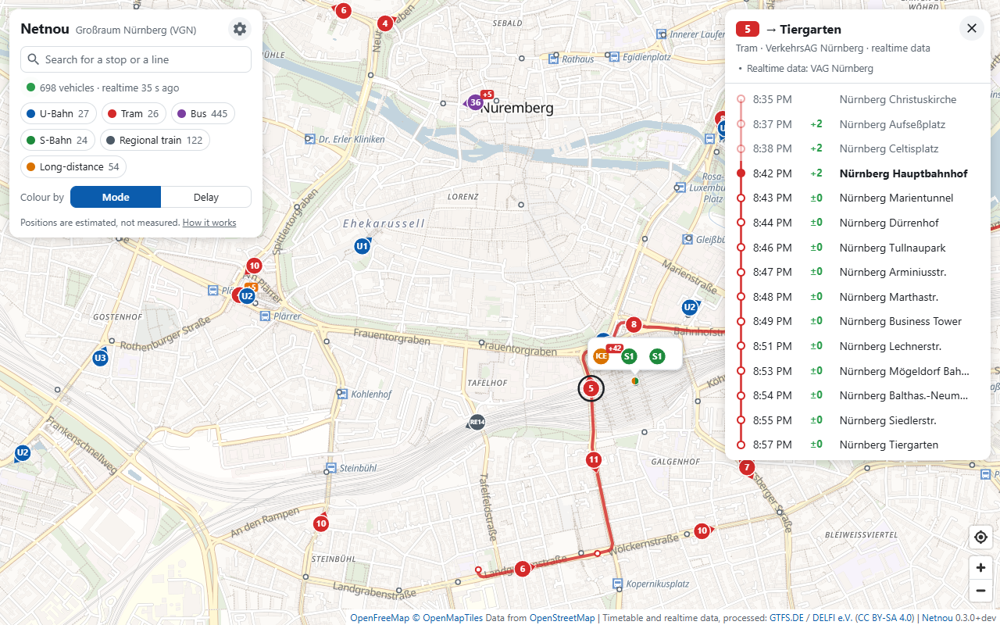

<p align="center">
  
</p>

<h1 align="center">Netnou</h1>

<p align="center">
  <strong>Eine Live-Karte für Busse und Bahnen</strong>
</p>

<p align="center">
  <a href="README.md">English</a> • Deutsch
</p>

---

Netnou zeigt Busse und Bahnen dort, wo sie gerade sind, mit ihrer Verspätung
und den nächsten Abfahrten an jeder Haltestelle.

**Ausprobieren:** Auf [öpnv.live](https://xn--pnv-rna.live) läuft Netnou für
ganz Deutschland.

**Die Positionen werden berechnet, nicht per GPS ermittelt.** Die Daten enthalten
Verspätungen, aber keine Positionen. Deshalb wird jedes Fahrzeug dort
gezeichnet, wo es laut Fahrplan und gemeldeter Verspätung gerade sein müsste.
Ein Fahrzeug kann also etwas vor oder hinter seiner Markierung sein.



## Was die Karte kann

- **Fahrzeug antippen:** seine Fahrt mit allen Halten, Zeiten und
  Verspätungen – so sieht man, wann es wo ankommt.
- **Heranzoomen, Haltestelle antippen:** die nächsten Abfahrten mit
  Verspätung – reicht es noch zum Bus?
- **Abfahrt antippen:** direkt zum Fahrzeug auf der Karte, um zu sehen, wo es
  gerade ist.
- **Suchen:** Ort, Haltestelle oder Linie. Eine Linie zeigt dann nur ihre
  eigenen Fahrzeuge.
- **Verkehrsmittel antippen** (U-Bahn, Tram, Bus …): blendet sie aus und
  wieder ein, zum Beispiel um nur die Züge zu sehen.
- **Teilen:** ein Link zu Haltestelle, Linie oder Fahrt, zum Beispiel um
  jemandem zu zeigen, wo der Bus gerade ist.
- **Als Tafel zeigen:** Abfahrten als große Tafel, zum Beispiel für ein
  Display an der Wand, mit bis zu vier Haltestellen.

Die Fahrzeuge lassen sich auch nach ihrer Verspätung einfärben. Die Karte kann
den eigenen Standort zeigen; er bleibt im Browser. Die Seite gibt es auf
Deutsch und Englisch, und sie lässt sich als App installieren.

## Etwas stimmt nicht?

- **Eine Zeit, eine Verspätung oder ein Ausfall stimmt nicht?** Das kommt aus
  den Fahrplandaten. Zeigt die App des Verkehrsunternehmens dasselbe, dann
  dort Bescheid geben: Vom Verkehrsunternehmen kommen die Daten über
  [gtfs.de](https://gtfs.de) zu Netnou.
- **Ein Fahrzeug fährt auf der Karte einen Weg, den es in Wirklichkeit nie
  nimmt?** Der Streckenverlauf kommt aus den Straßen und Gleisen von
  OpenStreetMap. Dort lassen sie sich [korrigieren](https://www.openstreetmap.org/fixthemap).
- **Ein Fehler oder eine Idee für die Karte?** [Ein Issue anlegen](https://github.com/xiidoz/netnou/issues/new/choose),
  auf Deutsch oder Englisch.
- **Eine Frage zu einer Seite, auf der Netnou läuft?** Wer sie betreibt, steht
  meist in ihrem Impressum, das die Seite selbst verlinkt.

## Selbst betreiben

Mit Docker:

```sh
docker compose up -d
```

Das lädt das veröffentlichte Image `ghcr.io/xiidoz/netnou`. `compose.yaml`
braucht sonst nichts aus dem Repository. Die Datei lässt sich also auch
einzeln herunterladen oder so, wie sie ist, in Portainer einfügen.

Mit Node.js 22 oder neuer, ohne etwas zu installieren:

```sh
npm start
```

Danach <http://localhost:8080> öffnen. Ohne weitere Einstellungen zeigt
Netnou den VGN, den Verkehrsverbund rund um Nürnberg, aus den bundesweiten
Daten von [gtfs.de](https://gtfs.de). Für ein anderes Gebiet genügen ein paar
Einstellungen, zum Beispiel für München (in einer POSIX-Shell; PowerShell und
Docker stehen in der Anleitung zur Konfiguration):

```sh
NETNOU_BBOX=48.06,11.36,48.25,11.72 \
NETNOU_AREA_NAME=München \
NETNOU_OSM_PBF_URLS=https://download.geofabrik.de/europe/germany/bayern/oberbayern-latest.osm.pbf \
npm start
```

`NETNOU_AREA=Germany` zeigt ganz Deutschland. Alle Einstellungen, wie sich ein
Gebiet beschreiben lässt und was Daten aus einem anderen Land brauchen:
[docs/configuration.md](docs/configuration.md) (englisch). Docker, Reverse
Proxys, Überwachung und eine öffentliche Instanz:
[docs/deployment.md](docs/deployment.md).

**Stand: frühe Entwicklung (0.x).** Die Einstellungen und die API können sich
noch von einer Minor-Version zur nächsten ändern. Im [Changelog](CHANGELOG.md)
sind solche Änderungen als „BREAKING CHANGES“ markiert.

### Was beim ersten Start passiert

Der Server lädt den Fahrplan für ganz Deutschland herunter (etwa 300 MB) und
schneidet ihn auf das Gebiet zu. Danach lädt er Ausschnitte aus OpenStreetMap
(etwa 500 MB für das voreingestellte Gebiet), um die Straßen und Gleise
zwischen den Haltestellen zu bestimmen. Mit einer schnellen Verbindung dauert
das zwei bis fünf Minuten. Bis der Fahrplan eingelesen ist, zeigt die Seite
einen Hinweis. Dann fahren die Fahrzeuge Luftlinie. Ein, zwei Minuten später
folgen sie den Straßen und Gleisen. Im Betrieb braucht der Server 150 bis
600 MB Arbeitsspeicher und startet beim nächsten Mal in weniger als einer
Sekunde aus seinem Cache. Die Zahlen für ganz Deutschland stehen in
[docs/deployment.md](docs/deployment.md#requirements) (englisch).

## Was eine eigene Instanz bietet

- Ein einziger Node.js-Prozess: keine Datenbank, zur Laufzeit keine
  npm-Abhängigkeiten, kein Build-Schritt. Die Echtzeitdaten werden nur
  abgerufen, solange jemand hinschaut.
- Eigener Name, eigene Beschreibung, eigene Icons und Links, etwa zu Impressum
  und Datenschutzerklärung:
  [In Suchmaschinen gefunden werden](docs/configuration.md#being-found)
  (englisch), [Icons](docs/configuration.md#icons-of-your-own),
  [Links](docs/configuration.md#links-of-your-own).
- Für jede Haltestelle, Linie und Fahrt eine Adresse zum Teilen, dazu eine
  Sitemap der Haltestellen und Linien für Suchmaschinen.
- Eine Ansicht für ein Display an der Wand: Abfahrten als große Tafel, mit
  bis zu vier Haltestellen
  ([Ein Display an der Wand](docs/deployment.md#a-screen-on-a-wall)).
- Besuche zählen mit einem frei wählbaren Analysedienst, dem der Server jeden
  Besuch meldet: kein Skript in der Seite, kein Cookie
  ([Besuche zählen](docs/configuration.md#counting-visits)).
- Eine offene JSON-API für andere Clients ([docs/api.md](docs/api.md)).
- Deutsch und Englisch, je nach Browser oder eigener Wahl; für eine weitere
  Sprache braucht es nur eine Datei ([docs/translating.md](docs/translating.md)).

## Mitmachen

[](https://github.com/xiidoz/netnou/actions/workflows/ci.yml)
[](LICENSE)

`npm test` braucht keine Installation und kein Netz. Wie man an Netnou
mitarbeitet, samt Commit-Nachrichten und Pull Requests:
[CONTRIBUTING.md](CONTRIBUTING.md) (englisch). Wie es innen funktioniert, vom
Import bis zu den Positionen: [docs/architecture.md](docs/architecture.md).

## Datenquellen, Lizenzen und Quellenangaben

Der Code steht unter der [MIT-Lizenz](LICENSE). Drei Dinge im Repository
stehen nicht darunter: die mitgelieferte Kartenbibliothek MapLibre GL JS
(`public/vendor/maplibre-gl`, BSD-3-Clause), die Icons aus Material Design
Icons (`public/vendor/material-design-icons`, Apache-2.0) und die Umrisse der
eingebauten Gebiete (`server/areas/vgn.geojson` und
`server/areas/germany.geojson`, © OpenStreetMap-Mitwirkende, ODbL 1.0).

Eine laufende Instanz arbeitet mit Daten, die sie selbst abruft und für die
eigene Bedingungen gelten:

- Fahrplan- und Echtzeitdaten: [gtfs.de](https://gtfs.de), bereitgestellt von
  DELFI e.V., CC BY-SA 4.0.
- Straßen und Gleise für die Streckenverläufe, dazu die Grenzen der Orte für
  die Suche: © OpenStreetMap-Mitwirkende, ODbL 1.0, als Ausschnitte von
  [Geofabrik](https://download.geofabrik.de/).
- Die Karte hinter den Fahrzeugen: Vektorkacheln von
  [OpenFreeMap](https://openfreemap.org) im OpenMapTiles-Schema, erstellt aus
  Daten von OpenStreetMap und vom Browser der Besucher geladen. OpenFreeMap
  braucht keinen Schlüssel und begrenzt die Zahl der Anfragen nicht.

Die Quellenangaben stehen auf der Karte und müssen sichtbar bleiben.
Einzelheiten und was daraus für den Betrieb einer Instanz folgt:
[THIRD-PARTY-NOTICES.md](THIRD-PARTY-NOTICES.md) (englisch).

## Haftungsausschluss

Netnou ist kein Angebot von VGN, VAG, DELFI e.V., gtfs.de oder einem
Verkehrsunternehmen und wird von keinem von ihnen empfohlen oder unterstützt.
Die Positionen sind Schätzungen, berechnet aus dem Fahrplan und den gemeldeten
Verspätungen. Verlassen sollte man sich nicht darauf.

Der Name ist Afrikaans: *net nou* heißt „gerade eben“, in Südafrika aber gern
auch „irgendwann später“. Das passt ziemlich gut zum deutschen
*ÖPNV*.
