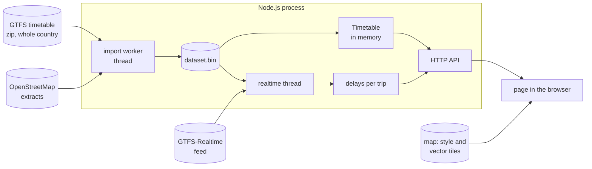

# Architecture

How Netnou turns a timetable, a list of delays and a road map into moving
vehicles. Read this before changing the server; the comments in the code
assume its terms.

- [Overview](#overview)
- [Why positions are computed](#why-positions-are-computed)
- [Modules](#modules)
- [The area](#the-area)
- [Import](#import)
- [Route geometry](#route-geometry)
- [Realtime](#realtime)
- [Failures and retries](#failures-and-retries)
- [Caches and format versions](#caches-and-format-versions)
- [The page](#the-page)
- [Known limits](#known-limits)
- [Glossary](#glossary)

## Overview

One Node.js process does everything. A worker thread cuts the nationwide
timetable down to the area and computes the route geometry; the result is one
file. The main thread loads that file into memory and answers the API. While
somebody is looking, another thread fetches the realtime feed and reads it
against the same memory. The page asks every ten seconds where the vehicles
in view will be and animates them in between.

There is no database and there are no npm dependencies at run time: the zip,
CSV, Protocol Buffers and OpenStreetMap PBF formats are read by small readers
in `server/lib`, each limited to what this project needs.

## Why positions are computed

The realtime feed of gtfs.de carries trip updates (delays) and alerts, but no
vehicle positions. A position is therefore derived:

1. For every stop of a trip, the expected arrival and departure are the
   timetable times plus the reported delay. A delay carries forward to later
   stops until the feed says otherwise. The times are forced to be
   non-decreasing.
2. Between two stops the vehicle moves along the route geometry of that
   hop in the time the timetable gives it, slower where its roads or tracks
   are slow and faster where they are fast (see *Speeds* below). Where there
   is no route it moves at constant speed along a straight line.
3. Without realtime data for a trip, the timetable alone is used. The page
   marks such a vehicle with a question mark while others have a delay
   reported. Without any realtime data it says so once, as a warning in the
   header card.
4. Trains that run coupled are a trip each, in the timetable and in the
   feed, and the feed may report a delay for one portion and not for the
   others. One train cannot be at two places: on the way the portions share
   from one stop to the next, all of them get the same delay at either end.
   What the feed reports for that stop itself counts before what is carried
   forward from an earlier stop. Of those that count it is the delay most
   portions have, and the largest where as many have one as the other. A
   portion the feed has no word on gets what the others say for that way.
   The delays of a trip, at its stops and on a departure board, are these
   too, so that they agree with the map.

The server does not send positions but *knots*: points in time and space along
the way ahead (see [Knots](api.md#knots)). The browser interpolates, so the
animation is smooth without a request per frame.

## Modules

Server (`server/`):

| File | Responsibility |
| --- | --- |
| `index.js` | HTTP server: static files, the API, the page at the address of a stop, a line or a trip, security headers, start and shutdown |
| `config.js` | reads and checks the settings (`loadConfig`) |
| `lib/area.js` | the area as a grid of cells with their distance to it (`Area`, `NEAR`) |
| `lib/feed.js` | keeps the timetable current: version check, download, worker, retries (`FeedUpdater`) |
| `lib/import-worker.js` | worker thread: import, route geometry, the towns of the stations, writing the dataset |
| `lib/importer.js` | cuts the GTFS feed down to the area and stores what repeats in it once (`buildDataset`); documents the dataset layout |
| `lib/dataset.js` | the dataset as a binary file (`writeDataset`, `readDataset`), loaded into memory that threads share (`loadDataset`, `datasetFrom`), texts as one block (`Texts`) and lists that are stored once (`SharedLists`) |
| `lib/zip.js`, `lib/csv.js` | read entries straight out of the zip (including zip64) and split CSV lines |
| `lib/osmpbf.js` | reads an `.osm.pbf` extract, the ways first and then the places of their nodes: its roads and tracks (`readPbfWays`) and its administrative borders (`readPbfBoundaries`) |
| `lib/network.js` | builds routable networks from the ways (`classifyWay`, `buildNetworks`), cuts the roads of a country into tiles (`tilesOf`, `windowOf`) and finds paths (`Network`) |
| `lib/shapes.js` | route geometry for every hop (`loadNetworks`, `buildSegments`) |
| `lib/kept-routes.js` | the routes of the hops, kept from one import to the next by the places of their stops (`KeptRoutes`) |
| `lib/towns.js` | which town a station is in: the towns among the borders of the extracts with their districts (`townsAmong`), kept between imports, and the town around a place (`townsOf`) |
| `lib/timetable.js` | the loaded dataset and the queries of the API (`Timetable`), and the part of it that realtime data is matched against (`Schedule`); finds the trains that run coupled (`findSharedWays`) |
| `lib/realtime.js` | says when the realtime feed is fetched (`RealtimePoller`), matches it to the trips and gives the portions of a coupled train the same delays where they share their way |
| `lib/realtime-worker.js` | the thread that fetches the feed, reads it and matches it |
| `lib/snapshot.js` | the realtime data of one fetch in columns: filled while the feed is read (`Gathering`), read by the timetable (`Snapshot`) |
| `lib/search-list.js` | the list the page searches in, as small as it gets: the stations in an order in which neighbours follow each other, with their places as differences and their towns named once, and the lines by operator (`searchList`); finds the station the list has at a place |
| `lib/http.js` | the GET the realtime feed is fetched with: patient with a busy server (`get`) |
| `lib/pb.js` | decodes the GTFS-Realtime message (`decodeFeed`) |
| `lib/update.js` | what the server calls itself (`describeBuild`) and the daily look-out for a newer release (`UpdateChecker`) |
| `lib/visits.js` | the visits of the page and of the stops, lines and trips opened in it, reported to the analytics service the operator names: what counts as one (`isVisit`, `isOpened`), its facts (`factsOf`), the request the patterns make of them (`reportOf`), and sending it (`Visits`) |
| `lib/time.js` | service days and the time zone of the feed |
| `lib/addresses.js` | what the address of a stop, a line or a trip names in the timetable, found again by the name and the place of the stop, the operator, kind and name of the line, or the line, day and start of the trip; what its page says of it (`Addresses`) |
| `lib/page.js` | which language the page is sent in, and what the server writes into it before it sends it: for search engines and previews of links, the header card as a visitor first sees it, and what the page is to fetch right away; `robots.txt` and the sitemap; which files of the operator's own take the place of built-in icons |
| `lib/files.js` | downloads, gzipped JSON files (the networks from OpenStreetMap), error texts |
| `areas/vgn.geojson` | outline of the default area, see [its README](../server/areas/README.md) |
| `areas/germany.geojson` | border of Germany, drawn as the edge of `NETNOU_AREA=Germany` |

Page (`public/`):

| File | Responsibility |
| --- | --- |
| `index.html`, `style.css` | structure and appearance; colours for canvas and DOM live in the style sheet |
| `app.js` | map, polling, animation, drawing on a canvas, detail panel |
| `display.js` | display mode and the board of a stop in the address of the page: what an address asks for, and the address for what is shown |
| `address.js` | the addresses of stops, lines and trips, for the page and the server: how a name is written in one, and what an address names (`stopPath`, `linePath`, `tripPath`, `parseAddress`) |
| `stops.js` | the stops on the map: how large the mark of one is, and the heart of a favourite, from which zoom which stops carry their names and where those go so that none lies on another, the marks of a station at its places and the lines that join them, the style of the map without stops of its own, and whether the name of a stop says its town |
| `choice.js` | the lines and directions of a stop chosen to be shown (#164): their keys, as the address and `/api/departures` take them, and what a tap does; for the page and the server |
| `favourites.js` | the stops and lines a visitor marks with the heart (#245): what is kept of them in the browser, and when a stop or a line of another timetable is the one kept |
| `panel.js` | what the details of a stop and of a line list, as a tree of elements: the page makes it into its own, the server writes it into the page of an address as it is at that moment (#254); for the page and the server |
| `search.js` | finding stops, lines and towns by name: matching and order, the favourites first, without the page around it |
| `nearby.js` | the stations the search suggests near the map before anything is typed (#257): stations close together as one place, the biggest places near the map or the busiest towns in view; for the page and the server |
| `search-worker.js` | the thread that loads the list of stops, lines and towns and searches it |
| `i18n.js`, `locales/` | texts in the visitor's language, see [translating.md](translating.md) |
| `first.js` | what is settled before the page is drawn: light or dark, by the visitor's choice or else the scheme of the device, whether the header card shows at once and in which language, and where the instance is (the base of the page) |
| `sw.js`, `manifest.webmanifest`, `icons/` | installable app and offline start |
| `vendor/maplibre-gl/` | the map library, vendored, see [its README](../public/vendor/maplibre-gl/README.md) |
| `vendor/material-design-icons/` | the shapes of the icons on the page's own buttons, see [its README](../public/vendor/material-design-icons/README.md) |

`tools/` holds eight scripts that are run by hand: `measure-feed.mjs` imports a
feed as the server does and prints what it comes to (trips, what repeats,
size, the time to say which vehicles are under way); `check-routes.mjs`
checks the routes of an import, or of two side by side (see [Route
geometry](#route-geometry)); `build-vgn-area.mjs`
regenerates the default area and `build-germany-outline.mjs` the border of
Germany; `build-icons.mjs` renders the app icons from `favicon.svg`,
`build-pictures.mjs` takes the pictures of the page for the READMEs, and
`build-social-preview.mjs` renders the image for link previews from them.
These three find their browser with `chrome.mjs`. The pictures come from a
server on the data in `tools/pictures/`, whose clock `frozen-clock.mjs`
holds at one moment; `build-picture-data.mjs` makes that data from a feed
and an OpenStreetMap extract.

## The area

The area is a set of polygons (`NETNOU_AREA_FILE`, or the built-in VGN) or a
rectangle (`NETNOU_BBOX`). `Area` rasters it into cells of about 1.1 km and stores
for each cell its distance to the area in cells, up to 8. "Is this point
inside, or within a few kilometres?" is then a table lookup, which matters
because it is asked for every stop of a national timetable and for tens of
millions of OpenStreetMap nodes.

Three distances, in cells, decide what counts (`NEAR` in `lib/area.js`):

| Name | Cells | Meaning |
| --- | --- | --- |
| `region` | 1 | a stop this close belongs to the area |
| `exit` | 4 | routes to stops far outside follow the network this far, then go straight |
| `osm` | 7 | OpenStreetMap data is kept up to here |

An instance may have no area (`NETNOU_AREA=Germany`) and may keep the trips of
some operators only (`NETNOU_AGENCIES`). The import then decides by the
operator of a trip, read from `agency.txt`, `routes.txt` and `trips.txt`
before the stop times, and where there is no area every stop counts.

What the area is asked for besides, which OpenStreetMap data to keep and
where routes follow the network, is asked of the **extent** in such an
instance: an `Area` without polygons, made in the import worker from the
dataset (`Area.covering`). A cell is inside if it has a stop of a trip or
lies on the straight line from a stop to the next, so that the tracks
between two stations far apart are kept as well. The main thread only needs
the rectangle around the stops, which the `Timetable` works out.

An area has an id, a hash of its polygons and the grid constants. Cached data
is tied to what the instance covers (`scopeId`): the id of its area alone
where that is all, else the area, or none, and the operators together. A
change to either invalidates the caches. The networks from OpenStreetMap
that were read for an extent carry its grid with them: they are used again
for as long as the extent of a new timetable lies within `exit` cells of
it, and read again when a trip reaches further.

## Import

`lib/import-worker.js` runs in a worker thread, because reading 40 million
rows keeps a core busy for a while. For the default area it reduces the feed
of all of Germany to about 98,000 trips and 13,500 stations.

1. **Stops in the area.** `stops.txt` is read once to find the stops within
   `NEAR.region` of the area.
2. **Trips.** `stop_times.txt` is streamed. Only the trip and stop ids of
   each row are looked at; a trip is kept if one of its stops is in the area,
   and only kept trips are parsed in full. This relies on the rows of a trip
   being next to each other; a trip whose rows come in two runs is put
   together. Missing times are filled in from their neighbours. A trip is
   stored as soon as it is whole, see [The dataset](#the-dataset).
3. **The rest.** `trips.txt`, `routes.txt`, `agency.txt`, `calendar.txt` and
   `calendar_dates.txt` are read for the kept trips, then `stops.txt` again
   for every stop they call at, also outside the area, and their parent
   stations.
4. **Interim dataset.** If the server has nothing to show yet, the dataset is
   saved without route geometry and loaded, so that the map works with
   straight lines while the next step runs.
5. **Route geometry**, see below.
6. **Dataset.** The trains that run coupled are looked for
   (`findSharedWays`), the result is written to `dataset.bin` and the main
   thread loads it.

Destinations and stop names are kept as the operators wrote them, but for
the marks their signs turn into a line break or a gap (`tidyName`, #223): a
word broken at the end of a line is one word again ("Meistersinger- _halle"),
with its hyphen where a capital goes on; `_` and a written `\n` or `\t` are a
gap; spaces count once. Nothing is mended for one operator: such fixes would
never end, and would go wrong once the operator corrects the text.

## The dataset

A timetable repeats itself: most trips run the same way as others, and many
at the same pace. The dataset holds what repeats once.

- **A pattern** is a sequence of stops. Every different one is stored once.
- **A profile** is a set of running times: for every stop the arrival and the
  departure in seconds, counted from the first departure of the trip. Every
  different one is stored once.
- **A trip** is a row of numbers: its pattern, its profile, its first
  departure, its service, its route and its headsign. Its
  `stop_sequence` numbers are a third kind of shared list, kept only where
  they do not count 0, 1, 2, …. The headsigns of its stops are a fourth,
  kept only where they change before its last stop (#225): 10,861 such
  lists for the 1.7 million trips of all of Germany, 246,000 numbers or 1 MB.

For the default area that is 16,000 patterns and 19,000 profiles for 93,000
trips with 1.8 million stop times; for the feed of all of Germany 241,000
and 272,000 for 1.9 million trips with 39 million.

While the import reads, a pattern or a profile is found again by a hash of
its numbers (`SharedLists`). Two different lists can have the same hash, so
on a hit the numbers are compared.

Everything is columns: a typed array for each property of all trips, all
patterns, all stops. Nothing holds an array for every trip. Texts that are
many and looked up, the ids of the trips and of the stops, are one block of
UTF-8 each (`Texts`). A trip or a stop is found by its id in a list of them
all in the order of their ids, which is stored with them; there is no map
with an entry for each.

The file is those columns as they are, after a head of JSON with everything
small (`lib/dataset.js`). Loading reads it into memory and lays the typed
arrays over it; nothing is parsed but the head. The memory is such that
threads share it: the one that reads the realtime feed lays its own arrays
over the same bytes (see [Realtime](#realtime)). The dataset of the default
area is 38 MB, 27 of them route geometry, and is loaded in a tenth of a
second.

What the API asks goes by pattern, not by trip:

- **A station knows the patterns that stop at it,** each with the position
  of the stop in the pattern, and a pattern knows its trips in the order of
  their first departures. A departure board looks among those for the trips
  that leave in the next two hours, and where they are fewer than ten, a
  second time for those of the next 24 hours: only at a quiet stop, so a
  busy one costs no more than before
  ([#165](https://github.com/xiidoz/netnou/issues/165)).
- **The vehicles under way:** the trips of a service day are put in the order
  of their first departures when the day is first asked for. That list is
  gone through up to the trips that have not started yet. A trip with
  realtime data may be under way outside the times of the timetable and is
  looked at by itself.
- **Where a vehicle is** is worked out from its profile and the geometry of
  the hop it is on. Its knots are only made when an answer needs them.
- **A zoomed-out map of a large instance** does not get every vehicle
  (`lib/thinning.js`). Once a minute the server counts the vehicles under
  way on the busiest screen of a phone, for every zoom; where that is more
  than a phone draws without trouble, an answer holds the same share of
  every kind of transport, picked by a number of chance that a trip keeps
  while it runs. So the kinds keep their proportions and a city stays as
  crowded beside the country as it is. A kind of which there are only a
  few is there whole, and so is the first vehicle of a kind in every square
  of the map: a single bus far out stays on it. `docs/api.md` has the rule.

Lines, stations and how much service a station has are worked out from the
columns when the dataset is loaded, which takes a few hundredths of a second
for the default area. The layout is described field by field above
`buildDataset` in `lib/importer.js`.

## Route geometry

The feed has no `shapes.txt`, so the path of every *hop* (two consecutive
stops of a trip, on one network) is found by routing over OpenStreetMap. For
the default area that is about 60,000 distinct hops, for all of Germany
790,000.

- **Reading an extract.** A way names its nodes, and an extract has its
  nodes first. `readPbfWays` therefore reads the ways first, keeps those
  that `classifyWay` takes, and then the places of just their nodes: of the
  441 million nodes of the extract of Germany, 32 million. That takes the
  extract of Germany (4.9 GB) two minutes and at most 1.8 GB of memory, and
  one of 100 MB a second or two.
- **Networks.** `classifyWay` sorts OpenStreetMap ways into six networks:
  `road` for buses; `tram`, `subway` and `rail` for vehicles on tracks;
  `ferry` for ferries, on the ways of their routes (`route=ferry`); and
  `cable` for cable cars and monorails, on monorails, funiculars, narrow
  gauge, tracks with a rack and aerial lifts that carry people. The U-Bahn
  and trams also run on each other's tracks and on those of the light rail
  (which `rail` has as well), at one and a half times the cost, so that a
  line keeps to tracks of its own kind where it can. The Stadtbahn of
  Stuttgart, Frankfurt, Düsseldorf and the Ruhr is U-Bahn in the feed, that of
  Cologne, Bonn and Bielefeld is tram, and both run on tracks that
  OpenStreetMap has as light rail, subway and tram
  ([#128](https://github.com/xiidoz/netnou/issues/128)). Trains share the
  tracks of trams and narrow gauge without a rack in the same way, and take
  them only where a hop has no route on tracks of rail, or no stop on them:
  the tram-trains in the streets of Karlsruhe, Kassel and Chemnitz, and the
  narrow gauge of the Harz and of Saxony, whose lines the feed gives the
  route type of rail ([#248](https://github.com/xiidoz/netnou/issues/248)).
  A stop is on tracks of rail where the nearest of them is no more than
  100 m further away than the nearest track it shares: a station of trains
  with the tracks of trams before it is, a stop of tram-trains in a street
  with a railway some hundred metres away is not. Roads carry a
  cost factor so that buses prefer main roads, and respect one-way streets,
  access restrictions and the exemptions for buses. The networks are kept in
  `osm-networks.bin`, as columns that are read again in a second, and built
  again when the OpenStreetMap data is older than
  `NETNOU_OSM_MAX_AGE_DAYS`, when the area or the list of extracts changes,
  and when `NETWORKS_VERSION` does: a timetable whose routes were found on
  networks of an older version is routed anew at the next start, and shows
  its routes until then.
- **Tiles.** The roads of a region are one network, as those of the default
  area are with 2 million nodes. Those of a country are too many for that:
  above 4 million nodes (`ROADS_AT_ONCE`) they are cut into tiles of a
  quarter of a degree (`tilesOf`), and a hop is routed on the roads of the
  tile its middle is in and of the eight tiles around it. A hop that has a
  stop more than half a tile beyond the tile of its middle is too long for
  that: in all of Germany 2,154 of the 756,709 hops on roads, nearly all of
  them of long-distance coaches. These are routed on one network of the
  main roads of the whole instance (motorways, trunk and primary roads with
  their links, which `classifyWay` marks: 2 million of the 30 million nodes
  of the roads of Germany) and of all roads near their stops, within 2 km of
  each or as far as the nearest main road and 2 km beyond it, at most 15 km
  (`routeLong`). Their search heads for the last stop (A*) and is not begun
  between parts of the network that are not connected. A stop beyond the
  extract is headed for as far as the roads lead, as from an area (see
  below). In all of Germany that gives 843 of the 849 of these hops with
  both stops on its roads a route, about 1.2 times as long as the straight
  line, and 306 of the 311 with one stop abroad; the 994 with both abroad
  stay straight. It takes a minute and 0.2 GB of memory more. The tracks of
  a country are one network each.
- **Lengths.** A network lies on a plane that is right at one latitude, that
  of the middle of the area or of the tile. A metre from west to east is
  measured at the latitude of each edge, and the distance of a stop from a
  way at the latitude of the stop: from the middle of Germany to its north
  and to its south that differs by a tenth.
- **Snapping.** A stop is rarely exactly on its road or track. Candidates on
  nearby edges are considered, up to 70 m away for buses, up to 400 m for
  trains (whose stop is often the centre of the station) and up to 600 m for
  ferries (whose pier can be far from where the line of their route ends),
  with a penalty per metre of offset. A stop keeps the six nearest on tracks
  of the network's own kind and as many on tracks it shares, so that where
  those are nearer they do not crowd out its own. A stop of trains keeps
  every edge of rail up to 100 m further away than the nearest, at most 64:
  in a large station the track a train takes need not be among the nearest
  few (at Frankfurt (Main) Hbf the 30th, 61 m away, for the line to
  Niederrad). Of the two stops of a hop, each keeps those nearer to it than
  to the other, or two stops close together would meet on one. An edge is found by the
  cells of a grid it lies in; a long one, as a ferry across the sea has, by
  the cells along it rather than all those of its rectangle.
- **Search.** A search from the candidates of stop A finds the cheapest path
  to one of stop B (Dijkstra's). On tracks it goes from edge to edge and knows
  which way it came: at a node a route turns at most 120°, so that a train
  does not go into a switch on one branch and out on the other, as if it
  could turn there like a car at a crossroads; it turns back at a stop, which
  every hop begins and ends at. No track that only goes on turns so much at a
  node (on rail 99.99 % of them less than 71°), and that turn is some 170°
  ([#243](https://github.com/xiidoz/netnou/issues/243)). Where no route keeps
  to that, the train does turn back between two stops, at a station it
  passes without a stop, or a corner is mapped sharper than it is: the route
  is then found as on roads. In all of Germany (feed of 20 October 2026)
  the routes of 11 of the 20,294 hops of trains with a route still turn
  back, and of 7 of trams, where 484 and 19 did before.
- **Plausibility.** A path much longer than the straight line (more than 2 to
  2.5 times plus a few hundred metres, depending on the network; for trains
  3 km, as they leave a terminus the way they face and come round: München
  Hbf to München Ost is 9.5 km for 4 km as the crow flies) is thrown
  away. This is a shortest-path guess, not the operator's official route;
  between stops a few hundred metres apart it is almost always the same.
- **Beyond the area.** Where one stop of a hop is outside the area, the path
  follows the network to about 4 km beyond the edge and continues in a
  straight line. The OpenStreetMap data may end before that, as the extracts
  of a federal state do at its border: the straight line then begins where
  the network stops leading towards the stop. The limit on the length applies
  here as well. Hops entirely outside mostly have no geometry. The same is
  done for a stop inside the area that is not near the network, or only near
  tracks of another kind, which need not lead there: a stop of trams above a
  tunnel of the U-Bahn.
- **Speeds** ([#264](https://github.com/xiidoz/netnou/issues/264)). A hop
  takes the time of the timetable, but not at one speed: every edge has the
  speed of its way, and the vehicle goes slower where that is slow and
  faster where it is fast, in the same proportion. The speed of a way is its
  `maxspeed` (or that of one direction, or an implied limit such as
  `DE:urban`), else one for its kind (`ROAD_SPEED`, `RAIL_SPEED`): 50 km/h
  on a primary road, 30 in a residential street, 100 on rail, 40 for a tram.
  A bus goes no faster than 80 km/h, 100 on motorways and trunk roads, and
  slower than the limit in town, as junctions, lights and traffic have it:
  60 % of a limit up to 50 km/h, 80 % of one of 60 or 70 (`TOWN_SHARE`).
  The straight line beyond the extract is as fast as the fastest part of
  the route. Pulling away and braking at a stop are not part of it. The
  networks keep the speed of every edge as half its km/h in a byte. In all
  of Germany (October 2026) a speed is tagged on 93 % of main lines of rail,
  90 % of motorways and 93 % of primary roads, but on a third of the tracks
  of the U-Bahn and 40 % of those of trams. A vehicle is then, at some
  moment of the hop, more than a kilometre from where one speed would have
  had it on 97 % of the hops of coaches longer than 20 km, 10 % of those of
  trains and 1.7 % of the other hops of buses: the ICE from Köln Hbf to
  Frankfurt Flughafen leaves Köln at 39 km/h, where it went 183 before, and
  is up to 14 km from where it was.
- **Fallback.** A hop without a path is a straight line. In October 2026 that
  was the case for about 1 % of the hops inside the default area. For all of
  Germany it was 1.1 % of the hops on roads, 11 % on rail, 2 % of trams and
  4 of the 2,908 hops of the U-Bahn. Of the 2,529 on rail (feed of 20 October
  2026), 2,346 have a stop with no track of rail within 5 km, abroad, beyond
  the extract of Germany (in Poland and the Czech Republic, Austria, France);
  149 have a stop more than 400 m from one, most of them near the border too;
  34 have none within the limit on the length, or none at all.
  `tools/check-routes.mjs` counts them, with the routes that turn back and
  those far longer than the straight line, and lists the worst.
- **Storage.** Paths are simplified to 1.5 m accuracy and stored once per
  hop, shared by all trips that use it. A hop is gone through from its
  first point on, so that point is stored as it is and each of the others as
  its step from the one before, in 16 bits each way; a step longer than a
  third of a degree is cut into shorter ones. The share of the hop's time up
  to a point, by the speeds of its parts, is stored in 16 bits as well, and a
  point is kept where the speed changes. That is 6 bytes a point: for all of
  Germany 18.3 million points, 126 MB with where every hop begins. A
  65,535th of the time of a long hop is a few metres: a vehicle is drawn up
  to 10 m from where a share of 64 bits would have it, on a coach from
  Warsaw to Berlin.
- **Time and memory.** For the default area the route step of an import
  takes the test machine about 40 seconds, the server at most 1 GB of
  memory. For all of Germany it takes 8 minutes, 3 to read the extract and 5
  to route, when none of the routes are kept, and the server at most 3.5 GB:
  it holds the timetable it serves meanwhile. The speeds of the edges take
  0.2 GB of that. Routing the tracks from edge to
  edge, with the tracks that trains share, takes 38 seconds of that where it
  took 27, and 0.1 GB more while they are routed.
- **Kept from one import to the next.** A route is found again by its
  network and the places of its two stops (`KeptRoutes`), and only the hops
  that are new are routed; a hop without a route is kept as such, so that it
  is not tried again either. The routes belong to the networks they were
  found on: with new OpenStreetMap data all of them are routed anew, while
  the server goes on with the routes it has. They are added to
  `osm-routes.bin` as they are found, so that a restart in the middle of
  routing goes on from there, and when routing is done the routes of the
  hops of the timetable are written anew. For all of Germany that file is
  240 MB. An import whose hops are all kept takes seconds for its routes and
  reads no networks, a minute in all and at most 2.4 GB. One in a hundred
  hops new, spread over the whole country, takes 2 minutes: the network of a
  tile is built for however few hops it has.

If no OpenStreetMap data can be loaded at all, the map works with straight
lines.

## Towns

The feed has the name of a stop and its place, and no town. Many names do
not say where they are: of the 245,000 stations that gtfs.de had for
Germany in October 2026, 38 % have a name without their town in it, and in
Munich, Stuttgart and Düsseldorf nearly all. The search is to find
"Marienplatz" by "münchen marienplatz" and to tell it from the one in
Stuttgart, so every station gets its town when the timetable is imported
(`lib/towns.js`).

- **Where the towns come from.** From the administrative borders of
  OpenStreetMap, in the extracts that are read for the route geometry
  anyway: no further download, and nobody else to credit. A municipality
  has `admin_level` 8 in Germany and in most of its neighbours. A city that
  is a district of its own has level 6, as the districts have, and Berlin
  and Hamburg have level 4, as the states have: of the areas above the
  municipalities those are towns that have no municipality in them. The
  name is the one OpenStreetMap has as `name`, the one on the signs.
- **Reading the borders.** A border is a relation that names ways, and a way
  names nodes, and an extract has its nodes first and its relations last.
  `readPbfBoundaries` therefore goes through the file three times, from its
  end: for the relations, for their ways, for the nodes of those. An extract
  says of itself that it is in that order, and each block is then unpacked
  for one of the three only. That takes a good second for an extract of
  100 MB, and for the one of all of Germany (4.9 GB, 11,000 towns) 55
  seconds and half a gigabyte of memory.
- **A border is its ways, not rings.** Two neighbours share the ways between
  them, so each way is kept once, and whether a place is inside a border is
  a matter of how many of its ways a line from there to the east crosses,
  in whatever order they are. A border counts if it is whole: all its ways
  are there, and at every point where one ends, an even number do. A way is
  the same in every extract that has it, so a town that lies across two
  extracts is whole with both, though with neither alone.
- **Finding the town of a station.** The borders are sorted into cells of a
  twentieth of a degree, and a station is tested against the few of its
  cell: a quarter of a million stations take two seconds. Where a place is
  in a municipality and in an area above, it is in the municipality.
- **What is kept.** The towns of an instance are kept beside its networks,
  in `osm-towns.json.gz`, and belong to the same reading of the extracts: a
  new timetable gets its towns from there, and when the extracts are read
  again, both files are written anew. For all of Germany that file is 19 MB.
- **Where no town is known.** Outside the extracts, and where OpenStreetMap
  has no whole border on the day: such a station is found by its name, as
  before. An instance without extracts has no towns. What is mapped like a
  town counts as one, so a stop in a forest or on a lake that belongs to no
  municipality has the name of that area.

In the dataset a station has the number of its town (`stops.town`), and the
towns that have a station are named once (`towns`), towns of one name apart.
Each has the name of its district beside it (`districts`): the area of the
next level of borders around it, which tells such towns apart, as the
search finds towns themselves (#24). The list of the search has them the
same way, with the district only for a name that more than one town has;
two of one name in one district are one town there, as OpenStreetMap has a
few places twice, a municipality and a forest beside it that belongs to
none.

## Realtime

`RealtimePoller` has the GTFS-Realtime feed fetched every
`NETNOU_REALTIME_INTERVAL_SECONDS`, but only while the API is in use (see
[Realtime polling and traffic](configuration.md#realtime-polling-and-traffic)).

Fetching, reading and matching the feed are the work of a thread of their
own (`lib/realtime-worker.js`). The feed covers a whole country whatever the
instance covers: reading it takes a third of a second for one transit
network and more than a second for all of Germany, which the thread that
answers requests would otherwise stand still for.

- **The timetable is not copied.** The dataset is loaded into memory that
  threads share, and the realtime thread lays a schedule of its own over it
  (`Schedule`, the part of `Timetable` that matching needs), without the
  lists of texts.
- **What a fetch comes to is columns of numbers** (`lib/snapshot.js`): for
  each service day the trips with realtime data in their order, so that one
  is found by looking through them, and for each of their stops the two
  delays as 16-bit numbers. The trip updates are taken one by one as the
  feed is read and written into the columns; none is kept. For all of
  Germany that is 10 MB, which change hands between the threads without a
  copy.
- **The thread lives for as long as there is polling for one timetable.** A
  new timetable ends it and the next fetch starts another, and so does the
  pause when nobody is looking. A thread that fails counts as a failed
  fetch.

Each fetch produces a new snapshot:

- **Matching.** A trip update is matched by `trip_id` and `start_date`. It is
  ignored if the trip does not run that day, or if a stop id in it differs
  from the timetable's; that protects against a mismatch on the day a new
  timetable is published. A predicted time more than six hours off the
  schedule is ignored as well.
- **Delays** per stop follow the GTFS-Realtime rule that a delay applies to
  later stops until the next update. Skipped stops and cancelled trips are
  recorded.
- **Alerts** addressed to a trip or a stop become notes, shown while one of
  their active periods is current. A note is the text of the alert and,
  where it has one of its own, its headline, with how serious the feed says
  it is; notes that warn come first. gtfs.de also uses an alert to
  name the operator who provides a trip's realtime data; that is recognised
  and offered as the trip's `source` instead of a note.
- **Staleness.** When fetching fails, the last delays are used until they are
  three minutes old; after that the server falls back to the timetable. When
  nobody is looking, the snapshot is dropped.

The feed is fetched with `get` of `lib/http.js`, not with `fetch()`. The
provider's server is slow to accept connections and slow to deliver at busy
times, and `fetch()` gives up on a connection after ten seconds, which cannot
be changed without a dependency. `get` has one limit for the whole request,
90 seconds for the realtime feed:

- While the server has not accepted the connection, it is asked again: after
  ten seconds without an answer, or after a pause that grows from one to
  eight seconds if the attempt failed at once.
- Once the connection is accepted, nothing is started over. The request waits
  for the answer and for the whole of it, however slowly it comes.
- A fetch may therefore outlast the polling interval. The turns of the
  interval that come meanwhile are left out.

## Failures and retries

- **Feed version check** (`HEAD`, every `NETNOU_FEED_CHECK_MINUTES`): a failure is
  logged and the check simply runs again next time. The loaded timetable
  stays in use.
- **Download refused** (HTTP error, no connection): tried again at the next
  check, since nothing was transferred.
- **Download broken off or import failed:** that version of the feed is left
  alone for an hour, then two hours, doubling up to a day. A new version is
  tried at once. This keeps a server whose import cannot succeed from
  downloading 300 MB every 15 minutes.
- **No route geometry:** the OpenStreetMap step is tried again after an hour,
  with the same doubling.
- **Start:** a setting that is not acceptable, a port that cannot be opened
  or a data directory that cannot be written ends the process with exit
  code 1.
- **Damaged cache files** are discarded and rebuilt. Cache files are written
  under a temporary name and renamed, so a crash cannot leave half a file.

The waits are kept in memory; a restart tries everything again at once.

## Caches and format versions

The data directory (`NETNOU_DATA_DIR`) holds:

| File | Content | Lifetime |
| --- | --- | --- |
| `dataset.bin` | the dataset: timetable of the area with route geometry | until a new feed version is imported |
| `osm-networks.bin` | the routable networks | `NETNOU_OSM_MAX_AGE_DAYS` |
| `osm-routes.bin` | the routes of the hops, by the places of their stops | as the networks they were found on |
| `osm-towns.json.gz` | the borders of the towns in the extracts | as the networks, with which they are read |
| `feed.zip`, `osm-<n>.pbf` | downloads | only during an import |

Everything can be deleted at any time and is rebuilt.

Four constants guard the formats. Bump them when you change what is stored;
otherwise a server would load a file written by older code:

- `DATASET_VERSION` in `lib/dataset.js`: the layout or meaning of anything
  in the dataset, including the route geometry.
- `NETWORKS_VERSION` in `lib/network.js`: `classifyWay`, the cost factors or
  the output of `buildNetworks`. The dataset says which version its routes
  were found on (`source.networks`).
- `TOWNS_VERSION` in `lib/towns.js`: what is kept of the borders.
- `KEPT_VERSION` in `lib/kept-routes.js`: the rules of routing, in
  `lib/network.js` and `lib/shapes.js`, or how routes are kept.

## The page

- **Map.** MapLibre GL JS draws the map with WebGL, from the vector tiles of
  the configured style or from raster tiles. Everything else is drawn by
  `app.js` on one canvas lying on top: the veil outside the area, the route
  of the selected trip or line, stations, the visitor's own position,
  vehicles. The route of a line is where its trips of the day run, each
  stretch between two stops once
  ([#148](https://github.com/xiidoz/netnou/issues/148)): the page asks for it
  once, when it opens the line, and shows it as far as it lies in the area.
  A route lies under the stops and their names, and its stops are the marks
  of the stations it calls at, each in a ring of the colour of its mode: the
  platform where a trip stops is not where the mark of its station is, the
  middle of its platforms, a median 21 m away at a bus stop, and a dot of
  its own would stand beside the mark or cover it. Where the map has no
  mark of a station, as zoomed out, a dot shows where the route stops; a
  station it passes keeps its mark as it is.
  The map is never rotated or tilted.
- **Polling.** Every 10 seconds the page asks for the vehicles in the visible
  section plus a margin, in full detail from zoom level 12 and in a reduced
  form below: with where each vehicle goes where a pointer can rest on it
  and ask, and in the smallest form on a touch screen and among thousands
  of vehicles. (Zoom levels are those of MapLibre, one less than the number
  in the address of a raster tile.) The page names its zoom and the kinds
  that are switched on, for which a large instance thins out its answer.
  Moving the map beyond what is loaded asks again at once, and so do
  switching a kind and zooming while vehicles are left out. A tab in the
  background stops asking, which lets the server pause the realtime feed.
- **Animation.** Vehicles are placed along their knots against the server's
  clock, and eased towards a new position when a changed delay moves them.
- **Several at one place.** Markers that would hide each other are drawn as
  one. Trains that run coupled are a trip each in the feed, which has no
  word on that they belong together; the server finds them by the way from
  stop to stop that they share at the same times of the timetable, and
  gives them the same `unit`. The page draws such a unit as one marker with
  the name of each train, one arrow and one delay, and each name opens its
  own trip. Whatever else is at one place, buses at a stop or trains at the
  same platform, is in a bubble above a dot that marks the place. "At one
  place" means at most 4 px apart on the screen, and standing there or
  heading the same way: vehicles that only pass each other are not, and
  those that stand near each other part when the map is zoomed in.
- **Detail panel.** A click on a vehicle shows its trip, a click on a station
  its departures, a line chosen in the search its vehicles under way; all
  refresh every 15 seconds. While a line is shown, the map draws its
  vehicles alone, with their names at any zoom and whatever the filters say.
  The badge at the top of a trip leads to its line, however the trip was
  opened. What the details are of, their head, stays at the top while what
  is listed scrolls below it.
- **Addresses.** A stop and a line each have an address of their own
  ([#37](https://github.com/xiidoz/netnou/issues/37)), to be passed on,
  kept and found by a search: `stop/nuernberg-plaerrer@49.4481,11.0648`,
  `line/verkehrsag-nuernberg/subway/u1` (`address.js`). The ids of a feed
  change with every timetable, so a stop is named by its name and its place
  to four decimals, about 10 m, and a line by its operator, its kind and
  its name. Where lines of that name are in places apart, the address of
  each has its place as well, to two decimals, about 1 km:
  `line/db-regio-ag-bayern/suburban/s1@49.56,11.14`. The words of an
  address are English, the names in it as the timetable has them, in small
  letters, ä as ae. Name and place tell every stop of the default area
  apart, and all but 92 of the 245,439 of all of Germany, which stand twice
  at the same place.
- **Found again.** The server takes the stop whose address it is, else the
  stop of that name nearest the place, up to 1 km away, else a stop of any
  name within 10 m of it, renamed (`lib/addresses.js`). The first matters
  where two stops of a name stand either side of where their places round
  apart: the place in the address of the one may be nearer the other.
  Measured from January to October 2026, that finds
  about 96 in 100 stops again after nine months. A line is found by its
  operator, kind and name; of lines of a name in places apart, the one
  whose address it is, else the one nearest its place, and without a place
  the busiest. A trip ([#178](https://github.com/xiidoz/netnou/issues/178))
  is named by its line, its day and when and where it starts,
  `trip/vag/bus/34/2026-10-17/0512-frd-ebert-platz`, and found as the run of
  its line that leaves its first stop then, from the stop of that name, else
  the only one that leaves then; it lives for its day, so its page is not
  for search engines. An address that names a stop or a line otherwise than its
  own address does now sends the browser on to that (301), and so does one
  with a slash at its end; one that names nothing is the page saying so,
  with 404, and with the search for the name in it. A browser that asks for
  a page at any other path where there is no file gets the page saying so
  as well (what asks for data gets JSON), and a path with a slash twice in
  a row is sent on to its clean form
  ([#198](https://github.com/xiidoz/netnou/issues/198)).
- **The address in the page.** Opening a stop, a line or a trip puts its
  address into the address bar, back closes it again, and a reload keeps it.
  A trip opened at its address brings the map to it: between the stop it
  left last and the next one, or to all of its run where it is not under way. The page finds its files and data from where the instance is,
  which `first.js` makes the base of the page: the server sends the page at
  an address with a `<base>` as many steps up as the address is deep. A
  button beside the close button of the details passes the address on: on a
  phone with the phone's own sheet, on a computer copied, which a note says
  for two seconds. Installed as an app, the page has no address bar of its
  own, so the button is the way to share there.
- **What search engines get.** At an address the server writes the title
  and the description of what it names into the page ("Abfahrten Nürnberg
  Plärrer live", with up to six of its lines, the busiest first, and the
  other kinds that call there; a stop whose name does not say its town
  with the town, "Abfahrten Bruck/ER Rotes Kreuz, Erlangen live"), its
  address as the canonical one, and the details opened as the page shows
  them at that moment ([#254](https://github.com/xiidoz/netnou/issues/254)):
  of a stop its name with that town below it, its departures, and its lines
  as links to their pages (#255); of a line its stops as links to theirs,
  with its vehicles along them (#256); either name the main heading of the
  page. The plain page links the stations near where the map first opens
  (#257). Before, the pages of all stops and lines were one
  page with a few words of their own, and no search engine had reason to
  keep them. Both are drawn by one module, `panel.js`, which the page
  makes into its own elements and the server into HTML, so that what a
  search engine reads is what a rider sees; the script takes the details
  over and keeps them live. A row says in its data what it opens, as the
  server's page has no script: the page listens to the details for it. The
  sitemap lists every stop and line, 14,228 addresses for the default area
  in one file, and the 269,995 of all of Germany in six files under an
  index, as a file may hold 50,000, each dated by its timetable.
- **Notes in the head.** Some operators write whole pages into one note and
  attach dozens to one trip, and the head does not scroll. So a note that
  does not fit shows its headline, or its first lines where it has none, on
  a button that opens it in full in a dialog, and the notes there is no room
  for are a line that names their number and opens them. On a narrow
  screen, where the details are a sheet, every note is one line and there
  are four lines for all of them, the page's own among them. On a wide one
  a note of up to 120 characters stands there in full and a longer one has
  two lines, and the notes of the feed may take a quarter of the height the
  details have by themselves, four lines in any case. What warns comes
  first, with the sign of a warning where the other notes have a bullet:
  that the trip is cancelled, then the notes the feed marks as warnings.
  In the lists of trains, the departures of a station and the vehicles of
  a line, a train with such a note has the sign after its delay, which the
  warning mostly explains; a pointer on the sign is shown what the warning
  says.
- **The details as a sheet.** On a narrow screen the details are a sheet
  from the bottom. The bar at its top and its head move it between three
  heights: its head alone, about half the screen, and up to the header
  card. Dragged and let go of slowly it comes to rest at the nearest of
  them; flicked, at the next one in that direction. Below the lowest it
  closes. A tap on the bar takes it one height up, and from the highest
  back to the middle. The height holds while the details stay open, and
  what is chosen on the map is moved into the part the sheet leaves free.
  There is no button to close in sight: the one there is, is for the
  keyboard and for screen readers and shows itself with the focus. "How it
  works" is such a sheet too and closes when it is dragged down. All of
  this is plain pointer events in `app.js`.
- **The lines of a stop to show** ([#164](https://github.com/xiidoz/netnou/issues/164)).
  Beside the departures a chip says which lines they are of, all ("Filter",
  #255) or only those chosen, and opens a sheet to choose them in: the directions of
  each line, where a direction is the line with the station it goes to next
  (`public/choice.js`), as the feed has no directions and the destinations of
  a line vary (the U1 has eleven at Nürnberg Plärrer). Each shows as the line
  is drawn as a vehicle on the map, its arrowhead turned to where it leaves
  the stop. The server chooses among the departures before it counts them
  (`/api/departures?lines=`): the 40 of a busy station would hold few of a
  line that comes twice an hour. The choice is in the address of the stop
  and of its board, and a favourite stop keeps it and opens with it; a
  further stop of a board shows all its lines. A screen on a wall
  (`display=fixed`) has no chip: it shows its stop as it was set up, at a
  platform the departures from that platform.
- **All lines of a stop** ([#255](https://github.com/xiidoz/netnou/issues/255)).
  A switch below the name shows either the next departures, by when they
  leave, or all lines of the stop, by kind and name, each beside its ways
  with the next departure each way. A way is a direction as for choosing
  (#164), named by where most of its trips go from here; the directions of
  a line with the same name are one way, as the RE1 leaves Nürnberg Hbf for
  München by six next stations. A way with no departure within 24 hours
  says so where the time stands: night buses on a weekday, replacement
  buses, trains to a stadium. The badge of a line leads to it, a link to
  its page that the page opens in its details. The server works the ways
  and their departures out of a day's departures of the station
  (`Timetable.linesAt`, a few milliseconds at the busiest), only while the
  page shows them (`/api/departures?list=lines`), and writes them into the
  page of the stop behind the switch, so that a search engine finds the
  lines as links. The chip beside the departures says "Filter" while every
  line is shown, as "All lines" is the switch beside it, and chooses among
  the departures only: the list of all lines shows them all. A board and a
  screen on a wall have no switch.
- **The stops of a line** ([#256](https://github.com/xiidoz/netnou/issues/256)).
  The details of a line list its stations in one direction at a time, a
  switch after "nach" naming the two by their destinations; on a line with
  a ring for each station, as a trip has its stops, each a link to its page,
  with the town below a name that does not say it. Only 22 % of lines call
  at the same stations both ways, so each direction has a list of its own:
  the run most of its trips take, with those of runs that go further added
  at its ends and the stations some runs have between two of its stations
  put in their place (`Timetable.lineWays`, worked out once for each line).
  That holds 90 % of the stations of all of Germany; what is left is on
  branches, drawn where they leave the line or join it, the line going on
  beside them. Below a station where a twentieth of the trips of the
  direction start or end, a line says so: half of all directions end at
  more than one station. A direction is named by the destination its
  trips show over most of the way they go, not by that of its short runs.
  Its vehicles are drawn on that line where they are, between the middles
  of the rows of their two stations as far as they have come, as the map
  draws them with their flags. In the page as sent they are an SVG over the
  list, placed by its attributes, as the CSP of the page allows no style
  attributes. In the page they are drawn as the map draws its own, with
  its helpers, on a canvas over the line of the list, along the times the
  server sends for each, every frame of the map's loop while they are
  shown; over each is a button that cannot be seen, for a tap, the
  keyboard and a screen reader, and the ring of the keyboard focus is drawn
  last on the canvas. An element that moves a third of a pixel a second
  went by whole pixels in Firefox and in Chrome on a phone, whether a
  transform set every frame, a layer of its own or an animation moved it;
  a canvas draws it where it is. Each opens its trip, and from a trip the
  line opens in its direction.
- **The board of a stop.** A button beside the share button enlarges the
  details of a stop into a board of its departures
  ([#81](https://github.com/xiidoz/netnou/issues/81)), the same on every
  screen: beside the map on a screen wider than high, below it on one
  standing upright, a phone among them. The map gives the board its share of
  the screen and keeps the stop in its middle; the edge between them is
  dragged by a grip in its middle, or moved with the arrow keys, from a
  quarter of the screen to three quarters, and from there to all of it, where
  the map is gone and the board names the timetable data at its foot. Its
  type grows with it (container query units), and it shows as many rows as
  it has room for, whole ones; a row is not a button. The board is part of
  the address of the stop (`board=<share>`), also with the controls, so that
  the address opens it again and `display=fixed` puts it on a wall. How
  departure times show is one setting for every list of them: the time of
  day, the minutes until a train leaves, counted from when it actually
  leaves and counting down between two answers of the server, or both; on
  the board a clock can be switched off. Minutes go up to an hour; a train
  further off shows its time of day in their place, and where the next day
  begins, a line says "morgen". A board has up to four stops
  ([#163](https://github.com/xiidoz/netnou/issues/163)), each in a block of
  its own or merged into the list of the block before it, the address naming
  them in the board's order (`with=`, `block=`). A merged list orders the
  departures of its stops by when they leave and ends at the earliest last
  departure of a stop whose answer the server's limit cut short, so that a
  busy stop does not seem to stop running. The blocks share the board's
  height, and stand side by side in columns where the board is wide enough
  for type of a readable size. The map rings every stop of the board; a stop
  a later timetable does not have stays in the address and says so in its
  place.
- **Search.** The field in the header card finds stops and lines by name.
  The list of all of them is fetched when the field is first used, and
  searched in the browser: what is typed stays there, and so do the
  visitor's position and what the map shows, which the order of the
  results makes use of. A stop matches if every word
  typed begins one of the words of its name, in any order; matches inside a
  word come after those, and close spellings are tried where nothing else is
  found. Among equally close matches the stop with more service comes
  first, and with the visitor's position known, service counts for less the
  further away a stop is. Without it, what the map shows is near
  ([#154](https://github.com/xiidoz/netnou/issues/154)): what is in view
  counts in full, and what is outside the less the further it is, at the
  scale of the view: as far outside it again as it reaches from its middle,
  a sixteenth. With the map on Hersbruck its Plärrer comes before the busier
  one of Nuremberg; with all of the country in view, service decides. The
  same holds for lines. `search.js` holds all of that and knows nothing of
  the page, so the tests run it as it is. Choosing a stop moves the map
  there and opens its departure board. A line is found by the beginning of
  its name, with its mode in front if somebody types one ("bus 33"), and is
  told from others of the same name by where it goes and who runs it.
- **Favourites.** A stop or a line becomes a favourite with the heart in its
  details ([#245](https://github.com/xiidoz/netnou/issues/245)), and is
  kept in the browser (`netnou.favourites`) by what its address says: its
  name and its place, and for a line its mode and operator as well, not by
  its id, which changes with every timetable. The search thread looks them
  up in its list as `/api/address` would, the stop of the name nearest the
  place within 1 km, and the line nearest within 10 km; one that a timetable
  no longer has is not listed. With nothing typed, the search lists the
  favourites, under the headings it has, the stops among them that are on
  the map first, then the others, each in the order they were marked
  ([#257](https://github.com/xiidoz/netnou/issues/257)): with thirty of
  them, those of the town on the map are at the top. While typing, a favourite that
  matches as closely as the search goes comes first among the stops or the
  lines, with a heart at the end of its row. The order of towns, lines and
  stops stays as it is. On the map a favourite stop is a heart in place of
  its pill, white with the dots of its kinds in rows that narrow as the heart
  does (`heartMark` in `stops.js`), at every zoom, with its name from zoom 11.
  Below zoom 14, where the map has no stops of its own, it lies above the
  vehicles, and a tap finds it before them; from there it lies with the other
  stops, under them. For that a stop is kept with its kinds, which the map
  has no stations to take them from when zoomed out. An open favourite has
  its ring in the shape of the heart, at the same distance all round, cut
  once on a canvas of its own. A screen on a wall shows none.
- **Stations near the map**
  ([#257](https://github.com/xiidoz/netnou/issues/257)). Below the
  favourites, with nothing typed, the search suggests stations a rider is
  likely to look for, under "In der Nähe": five, as many fewer as there are
  favourites beyond two, and two from five favourites on, so that together
  they fill the seven rows the list shows on a phone. Trips alone would
  bring up bus stations: the feed splits most main stations into several
  stations, Hamburg Hbf into seven, and the one with the long-distance
  trains has the fewest trips of them. So the stations within 300 m of each
  other are one place, which counts their trips, each station's times the
  number of kinds that stop there, so that an interchange outweighs a bus
  station; and a place is suggested by its station with the
  furthest-reaching kind, long distance first. Zoomed out further than a
  town (the view reaches more than 15 km from its middle) the towns with the
  most trips near the map are suggested, each by its biggest place: Berlin,
  Hamburg, München, Frankfurt and Düsseldorf Hbf for all of Germany; zoomed
  in, the biggest places near the map, at least 600 m apart or a tenth of
  how far the view reaches. Near is what it is for the order of the search,
  the visitor where their position is shown. `nearby.js` holds the rule,
  for the search thread, which works out the places once for its list
  (0.4 s for all of Germany on a desktop, a few milliseconds for each
  question then), and for the server, which writes the suggestions of the
  instance's first view into every page it sends, as links to their pages
  in the list of the search, not shown until the search is opened: from
  them a search engine finds its way to the lines of each and on to all
  their stops (#254).
- **What a line is.** The trips of a name, mode and operator that share
  stations, also through others
  ([#152](https://github.com/xiidoz/netnou/issues/152)): DB Regio runs an
  S1 in Nuremberg and one in Munich, and one operator runs the trams of
  Chemnitz and of Zwickau. In all of Germany (feed of 14 October 2026) 1,020
  of the 24,558 names of lines are lines in more than one place, in the
  default area 11. A line that runs in pieces, such as around works, is its
  pieces, each with its own destinations. A line has
  the middle of its stations as its place, and among those of its name it
  is asked for by that (`/api/line?at=`); a trip names the place of its
  line (`lineAt`), so that its badge opens the one it is on.
- **The town of a stop.** A word typed may also be a word of the [town](#towns)
  a stop is in, whether its name says the town or not, and it may be typed
  as a word of a name may: in part, without its umlauts, with a slip. A
  result has its town below its name where the name does not say it, which
  is where a word of the name is the town, or the first long word of it:
  "Marienplatz" has "München" below it, "Nürnberg Plärrer" has nothing, and
  "Nürnberger Straße" has its town, since many towns have one; so has
  "D-Froschenteich", whose D says Düsseldorf only to whoever knows it. The
  stops of a trip through more than one town have their towns below their
  names by the same rule
  ([#246](https://github.com/xiidoz/netnou/issues/246)): Erfurt's
  "Hauptbahnhof" on the way from Berlin to München. Those of a trip within
  one town have none.
- **The list of the search.** All of Germany is a quarter of a million
  stations, and every visitor who searches loads the list of them. It is
  therefore as small as it gets (`lib/search-list.js`,
  [`/api/search`](api.md#get-apisearch)): one column for each property, the
  names as one text and the places as whole numbers. The stations are in the
  order of a curve that goes through every place of the map (Hilbert's), so
  each is near the one before it, and a place is written as the small
  difference from that one. The towns are named once, and a station has the
  number of its own: in that order the stations of a town follow each
  other, and the towns add 3 to 4 %. Compressed the list is 3.0 MB for all
  of Germany and 170 kB for the default area.
- **A station of the search has no id.** The ids of a feed need not outlast
  one version of it: of the 112,000 stations that gtfs.de had under the same
  name at the same place in January and in October 2026, not one had kept
  its id. In the list they would be a quarter of its size. The departures of
  a station found by the search are asked for by its place instead, and the
  list gives every station a place of its own.
- **The search has a thread of its own.** `search-worker.js` loads the
  list, gets it ready and searches it, so that none of this holds up the
  page: with the list of a country, getting it ready takes a phone about a
  second. Of the questions that come in while the thread is busy it answers
  the last.
- **A word is looked for by reading through the names.** Nothing is built
  for each stop. The words of all names, as they are compared, are one text,
  and a word typed is looked for in it from end to end. The longest word
  typed comes first, as the fewest names have it, and the other words are
  looked for only in the names it left. What a name abbreviates ("Hbf",
  "…str.") is found by the forms of the word typed that such a name answers
  to, and an abbreviation that is typed is looked for as the word it stands
  for as well: "hbf" finds a "Hauptbahnhof". For the list of a country a search takes a few milliseconds on a
  desktop machine.
- **A town is a result of its own** (#24), and choosing it shows all its
  stations on the map. It is found where a word of its name begins with each
  word typed, from three letters on; not by a word inside its name or with a
  slip, as a stop is, since the towns come before the stops and would push
  them aside. Of exactly the name typed it comes first, the others by the
  service of their stations, near the visitor or the map as a stop is, and
  three at most. Its service and the rectangle around its stations are
  added up from the stations when the list is got ready.
- **Own position.** A button above the zoom buttons shows where the visitor
  is and has the map follow them, until they move the map themselves or
  switch it off. It is off at every start, and a visitor outside the area is
  told so while the map stays where it is. The marker lies under the
  vehicles, with a ring wider than their markers, so that both show when the
  visitor is in one. The button and the following are the page's own, only
  the icons are those of MapLibre's `GeolocateControl`: that control moves
  the map before it says where the visitor is. The position stays in the
  browser ([what the server gets to see](deployment.md#running-a-public-instance)).
- **Offline start.** The service worker fetches from the network first and
  falls back to its cache, so an update shows up immediately and the
  installed app can still start without a connection (and then says that it
  needs one). It takes the page it has kept, in whatever language that came.
  API answers and the map are never cached.
- **A new version.** A page that stays open runs the version it was loaded
  with: a tab, a phone that brings its tab back without loading it, the
  installed app, a screen on a wall. And what it loads later, such as the
  thread of the search, would be of the new version. So it asks `api/status`
  which version runs, as it comes into view and every five minutes while it
  is, and once that has changed loads itself again where nobody is using
  it: as it comes into view, after two minutes without a touch, a click or a
  key, and on a wall at once. What is open is in the address and stays.
- **Texts** come from locale files through `t()`; nothing a visitor reads is
  written out in `app.js` or in the server, apart from data such as
  names of stops and notes of the feed. See [translating.md](translating.md).
- **Before any script runs** the page already says what and where the
  instance is: the server writes the title, the description, the name of the
  instance and the name of the area into `index.html` when it sends it, in the language the
  address asks for (`?lang=de`), else in the one the browser asks for, else in the main language
  of the instance, with the tags for
  previews of links and, if it knows its public address, the canonical
  address and the versions in other languages. That is what search engines
  and chats read. The script puts the same texts in for the visitor, in
  their language; both take them from `pageTexts` in `i18n.js`. A title or
  a description of the operator's own (`NETNOU_SITE_TITLE`, `NETNOU_SITE_DESCRIPTION`)
  takes the place of the page's in both, as it is: one for every language,
  or one for each. At the address of a stop, a line or a trip the script
  keeps the title and the description the server wrote of it, unless the
  visitor chose another language in the settings, which the server knows
  nothing of: then it writes its own, in that language. The
  manifest of the installed app gets the name, the language and the
  description of the instance the same way.
- **The header card comes with the page.** The scripts are large, the map
  library above all, and on a phone they take seconds to arrive. Until they
  have run, a visitor sees the page as the server sent it. So the server
  sends the header card whole: its texts in the language of the page, its
  icons drawn, a chip for every mode its timetable has (`renderPage`). Where the address
  names no language, the page is sent in the one its own script would pick
  for the browser that asks, from the languages the browser names with its
  request (`languageFor`); the answer says that it depends on them
  (`Vary: Accept-Language`). `first.js`, the one script the page waits
  for, picks the visitor's language as `i18n.js` does and shows the card
  with the first paint where the page came as this visitor gets it. Where
  the language alone is another – a browser that names none, a language
  chosen in the settings – it fetches the texts, a small module, and shows
  the card in them long before `app.js` has arrived. Where more is another
  – modes switched off, colours by delay, a display – the card stays out of
  sight until `app.js` has made it so: it would change under the eyes of
  who reads it otherwise. What `app.js` adds to a card that shows already
  is what its buttons do, the numbers on the chips and the state of the
  connection. On a wide screen the chips come folded (`style.css`), or open
  where the visitor opened them (`first.js`): the card has its height from
  the first paint.
- **The page paints as soon as it has arrived.** Its style sheets and
  `first.js` are what a browser has to have before it paints, and each
  would be a request of its own, most of a second on a phone. The server
  writes them into the page as it sends it, byte for byte (`PAGE_INLINE` and
  `renderPage` in `lib/page.js`), and the answer allows them by their
  hashes in its Content-Security-Policy (`inlineHashes`, `securityPolicy`).
  `index.html` names them as files all the same, and they are served as
  files too: the page works from a plain web server as well.
- **What the page fetches at its start** it would learn of step by step: of
  `app.js` from the page, of the map library from `app.js`, of the area and
  the style of the map only once the script runs. The server names all of it
  in the head of the page (`PAGE_MODULES` and `renderPage` in `lib/page.js`):
  the scripts with the texts of the page's language, `api/area` and
  `api/status`, and the style of the map, or with raster tiles the
  connection to their server. The browser then asks for everything at once –
  the texts and `i18n.js` first, which the header card of a visitor whose
  language is another than the page's waits for, the rest, the map library
  above all, with less urgency (`fetchpriority`).
- **Security.** The Content-Security-Policy allows scripts, styles, workers
  and connections from the page's own origin only. The one exception is the
  map, which may be fetched from the server of its style or tiles and from
  those in `NETNOU_MAP_ORIGINS`. The only inline script and styles are the
  page's own `first.js` and style sheets, which the answer that is the page
  allows by their hashes; every other answer allows none. No other site may
  show the page in a frame, unless it is named in `NETNOU_EMBED_ORIGINS`
  (`securityPolicy` in `lib/page.js`).
- **Browsers.** There is no build step, so the page runs as written. The map
  library sets the floor: it needs WebGL 2 and the JavaScript of 2022,
  roughly Chrome and Edge 94, Firefox 114, Safari 16.4 and newer.
- **Accessibility.** Filters, the settings, the search, the dialogs, the detail
  panel and its lists are ordinary controls and work with the keyboard; the
  search is the way to a station without a pointer. On the canvas, vehicles
  and stations can be selected with a pointer only.
  On a narrow screen the filters are one row that scrolls sideways; arrows at
  its ends show that it goes on and move it. On a wide screen filters that
  take more than two rows fold to a row and a half, and the faded row or an
  arrow opens them; a filter beyond the first row that gets the focus opens
  them as well. The arrows are left out of the tab order and hidden from
  screen readers, which reach every filter directly.

## Known limits

- Positions are estimates. Between two stops the speed follows the speeds
  of the roads and tracks, not the vehicle's own, with no time to pull away
  or to brake, and a route is a shortest-path guess.
- The feed's own `shapes.txt` is ignored.
- Kinds of train are recognised by line names as used in Germany.
- One time zone for the whole feed (`NETNOU_TIMEZONE`); `agency_timezone` is not
  read.
- A timetable server without `ETag` and `Last-Modified` is never refreshed.
- Alerts for whole agencies, routes or route types are not shown. Of an alert
  in several languages the German text is used.
- The departure board is fixed at two hours and 40 entries, or the next ten
  within 24 hours.
- The grid of the area assumes a latitude of about 49–50° north.
- The installed app's name and description (web app manifest) are in English
  only. Right-to-left languages are not prepared.
- The API has no rate limiting.

What these mean for other feeds and countries, and where to change them:
[configuration.md](configuration.md#other-feeds-and-other-countries).

## Glossary

| Term | Meaning |
| --- | --- |
| area | the region covered, from `NETNOU_BBOX` or `NETNOU_AREA_FILE` |
| stop | a row of `stops.txt`, often a single platform |
| station | the stop that groups platforms (`parent_station`); what the map shows and a departure board is for |
| pattern | a sequence of stops, stored once for all the trips that run it |
| profile | a set of running times, stored once: arrival and departure at every stop, counted from the first departure |
| hop | two consecutive stops of a trip |
| network, net | one of the six routable graphs: `road`, `rail`, `subway`, `tram`, `ferry`, `cable` |
| segment | the routed path of a hop on one network |
| knots | `[time, lat, lon, …]` along a vehicle's way ahead |
| mode | kind of transport as the page shows it, see [Modes](api.md#modes) |
| service day | the day a trip belongs to in the timetable; its times can exceed 24:00 |
| dataset | the timetable of the area with its route geometry, as stored in `dataset.bin`, see [The dataset](#the-dataset) |
